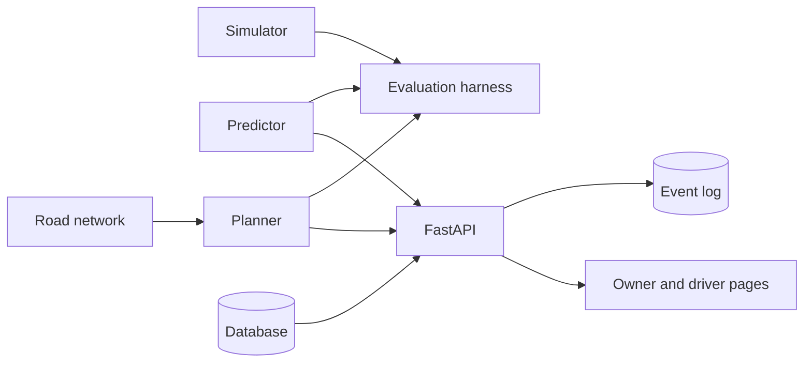

# Gasora

**Predictive depletion modeling and capacitated vehicle routing for decentralized LPG networks.**

Gasora helps an LPG distribution agency decide which customers to deliver to, and in which order. It
predicts when each customer's cylinder will run out, plans delivery routes that respect vehicle capacity and
shift length, tracks empty cylinders that customers have not returned, and checks all of this against simpler
policies on simulated agencies. A web application records customers, deliveries and routes around that engine.

> **Status:** active development. All evidence comes from simulation. The project has no real customer data,
> so it makes no claims about real-world savings.

## Overview

Gasora has two connected parts.

**Decision engine (predict, plan, verify)**

- **Simulator:** simulated customers on a real city road network, with steady and irregular usage patterns and
  an optional model of empty cylinders that customers keep.
- **Predictor:** estimates each customer's 48-hour run-out risk and a refill window (earliest and latest likely
  day) from the customer's own delivery history. It borrows from similar customers when history is short and
  assigns a band (Normal, High, Critical). The old rule (average days between deliveries) is kept as a baseline.
- **Planner:** Google OR-Tools routing on road travel times, in which every customer is an optional stop. The
  penalty for skipping a customer is their risk times an emergency cost. Urgent requests get a very high
  penalty and a pull towards the start of the route. Customers who have kept empties for 15 days or more
  become swap candidates (see below).
- **Evaluation harness:** runs delivery policies day by day on the same simulated agencies and compares them
  with paired seeds and bootstrap intervals.

**Operations layer (records)**

- Login with owner and driver roles.
- Customers, deliveries, urgent requests.
- A cylinder register (state, owner, history) with audited state changes.
- An empties ledger: cylinders delivered minus empties collected, with ageing buckets of 15, 30, 60 and 90+ days.
  Overdue empties become swap candidates in the plan. A swap is a normal delivery stop, not an extra trip.
- Route publishing and driver assignment, an owner dispatch page with road routes, and a mobile-friendly driver
  page where drivers mark stops delivered or skipped and enter the empties collected.
- A hash-chained, append-only event log with a verification endpoint.



## Project structure

| Folder | Contents |
|---|---|
| `simulator/` | Customer generator with hidden usage patterns |
| `predictor/` | Baseline rule, run-out risk, refill window |
| `planner/` | OR-Tools routing, greedy routing, road-time matrix and road router (OpenStreetMap) |
| `evaluation/` | Day-by-day harness, delivery policies, final comparison, matched-workload, breakdown by customer type, empties study, calibration check |
| `backend/` | FastAPI application, models, authentication, services, cylinder register, event log |
| `frontend/` | React, Vite and Leaflet web application |
| `tests/` | Automated tests |
| `data/` | Generated files: road map, caches, local databases, result tables (not tracked by Git) |
| `docs/` | Documentation |

## Getting started

### Prerequisites

- Python 3.12 or newer
- Node.js 22 or newer
- Git

Developed with Python 3.14 and Node.js 24. The backend test suite also passes on Python 3.12.

### Installation (Windows PowerShell)

```powershell
git clone https://github.com/Sumamasonia/gasora.git
cd gasora
python -m venv .venv
.\.venv\Scripts\Activate.ps1
python -m pip install --upgrade pip
pip install -r requirements.txt
cd frontend
npm install
cd ..
```

If PowerShell blocks the activation script, run `Set-ExecutionPolicy -Scope CurrentUser RemoteSigned` once.

Verify the installation:

```powershell
python -m pytest -q
python -m evaluation.feasibility_check
```

All tests should pass. The feasibility check prints a risk summary for 50 simulated customers and an OR-Tools
plan. Route lengths can differ slightly between machines, because the solver stops on a timer.

### Run the application

1. Download the road network once (needs internet; retries if the public server is busy):

   ```powershell
   python -m planner.download_map
   ```

2. Create a demo database with simulated customers and two accounts:

   ```powershell
   python -m backend.manage seed-demo
   python -m backend.manage warm-roads
   ```

   Demo accounts: `owner` / `owner-demo-123` and `driver1` / `driver-demo-123`. For demonstrations only.
   `warm-roads` computes road travel times for all customers once (about 40 seconds for 60 customers).

3. Start the API and the web application in two terminals:

   ```powershell
   python -m uvicorn backend.main:app --reload
   ```

   ```powershell
   cd frontend
   npm run dev
   ```

4. Open http://localhost:5173. API documentation is available at http://127.0.0.1:8000/docs.

Additional accounts: `python -m backend.manage create-owner NAME` and
`python -m backend.manage create-driver NAME`.

To check the road travel times against a map service, compare a trip with
`python -m planner.check_times LAT1 LON1 LAT2 LON2`.

### Configuration

| Setting | Purpose | Default |
|---|---|---|
| `GASORA_SECRET` (environment) | Signs login tokens. Set your own value outside development. | development value |
| `GASORA_DB_URL` (environment) | Database connection | `sqlite:///data/gasora.db` |
| `GASORA_EVENTS_PATH` (environment) | Event log database file | `data/gasora_events.db` |
| `GASORA_ROUTING` (environment) | `auto`, `road` or `straight` | `auto` (road if the map file exists) |
| `config.py` | Vehicles (2), capacity (40 cylinders), shift (480 minutes), service time, penalties | see file |
| `backend/settings.py` | Early-arrival costs, empties ageing tiers and weights, depot position | see file |

Most values are placeholders pending calibration (see Known limitations).

### API overview

| Area | Endpoints |
|---|---|
| Authentication | `POST /auth/login`, `POST /users` |
| Customers and deliveries | `/customers`, `/deliveries` |
| Planning | `GET /plan/today`, `POST /plan/publish`, `GET /routes`, `PATCH /routes/{id}/assign`, `POST /paths` |
| Driver | `GET /my-routes`, `POST /route-stops/{id}/deliver`, `POST /route-stops/{id}/skip` |
| Urgent requests | `POST /urgent`, `GET /urgent` |
| Empties | `GET /empties`, `POST /empties/adjust` |
| Cylinder register | `/cylinders` (register, list, state changes, summary) |
| Audit | `GET /audit/verify` |

## Evaluation

The harness simulates an agency day by day. Each policy sees only what a real system could know: delivery
history, days since the last delivery, and which customers have called because they ran out.

| Policy | Selection | Routing |
|---|---|---|
| P1 | Reactive (customers who ran out) | Nearest neighbour |
| P2 | Average-days rule | OR-Tools |
| P3 | Gasora risk | OR-Tools with risk-weighted skip penalties |
| Ablation | Gasora risk | Nearest neighbour |

The ablation separates the effect of prediction (whom to visit) from the effect of routing (how to drive).
Hidden cylinder durations are drawn per customer in advance, so every policy faces the same simulated world
(paired seeds). A warm-up period that is not counted lets the simulation forget its arbitrary starting state.

Measures: run-outs per 100 customer-months, kilometres per delivery, total kilometres, early deliveries,
customer-days without gas (empty cylinders waiting at customers), vehicles used, forecast error and refill
window coverage.

```powershell
python -m evaluation.final                      # main comparison: roads, 200 customers, 20 seeds
python -m evaluation.matched --seeds 20 --days 60 --warmup 30 --n 200 --source road --lean
python -m evaluation.breakdown                  # steady against irregular customers
python -m evaluation.empties_study              # ageing alerts and swap candidates
python -m evaluation.window_check --seeds 20    # refill window calibration and forecast error
python -m evaluation.sensitivity --seeds 3      # exploratory: cut-off and penalty settings
```

Long runs save their results after every seed. Run the same command again to continue after an interruption.
Close heavy programs while they run: OR-Tools stops on a timer, so a busy computer changes the numbers slightly.

### Results (simulation)

Settings: road distances, 200 customers, 2 vehicles with 8-hour shifts, 30 warm-up days and 60 counted days,
20 paired seeds. These shift and vehicle values are assumptions.

| Policy | Run-outs per 100 customer-months | Deliveries | Total km |
|---|---|---|---|
| P1 reactive | 158.4 | 634 | 2,969 |
| P2 average-days rule (alert 2 days before) | 65.3 | 720 | 2,856 |
| P3 Gasora, risk cut-off 0.05 | 13.3 | 1,174 | 3,149 |
| P3 Gasora, risk cut-off 0.10 | 23.1 | 952 | 3,214 |
| P3 Gasora, risk cut-off 0.20 | 44.4 | 788 | 2,966 |
| Ablation: Gasora risk with nearest neighbour (0.10) | 23.1 | 953 | 3,705 |

What the evidence supports:

- **Against the old rule at its usual setting,** Gasora (cut-off 0.10) has far fewer run-outs, at the price of
  about 32% more deliveries and 12% more kilometres. The cut-off sets the trade-off.
- **Routing:** for the same customers and the same run-outs, OR-Tools uses about 13% fewer kilometres than
  nearest neighbour (-491 km, 95% interval -514 to -468).
- **At equal numbers of deliveries,** Gasora's advantage over a tuned average-days rule is small and not the same
  at every workload. Run-outs differ by between 2.8 fewer and 1.7 more per 100 customer-months (clearest at
  cut-off 0.10: 2.8 fewer, interval 2.2 to 3.4). At the highest workload (cut-off 0.05) Gasora needs about 12%
  fewer kilometres (-432 km, interval -458 to -407).
- **By customer type,** the predictor does not outperform a tuned rule on irregular customers in this simulation
  (cut-off 0.10: 2.2 more run-outs per 100 customer-months, interval 0.5 to 3.9), and shows no difference on steady
  customers at that cut-off.
- **Calibration:** the 80% refill window contains the true run-out day in 76% of predictions (steady customers
  73%, irregular 82%).
- **Road travel times** were compared with a map service on three trips (differences from -23% to +7%). The model
  has no traffic, and road-type speeds are assumptions.

These are simulated results from a predictor whose assumptions match the simulator. They show how the method
behaves when its model fits, not how it performs on real data.

## Testing

```powershell
python -m pytest -q
```

Tests cover authentication and roles, deliveries, urgent requests, route publishing and driver actions,
planning and road routing, the cylinder register, the empties ledger and swap candidates, the evaluation
harness, and tamper detection in the event log.

## Project status

Implemented:

- [x] Simulator with steady and irregular customers, on a real road network
- [x] Run-out risk predictor with bands, refill window, and the average-days baseline
- [x] OR-Tools planner with optional stops, capacity, shift length, urgent requests, road travel times
- [x] Evaluation harness, final comparison, matched-workload and breakdown studies, calibration check
- [x] Authentication, roles, customers, deliveries, urgent requests, route publishing, driver actions
- [x] Cylinder register with audited state changes
- [x] Empties ledger, ageing buckets, swap candidates in the plan
- [x] Hash-chained event log with verification and tamper tests
- [x] Owner dispatch page and driver page

Planned:

- [ ] Empties study results (the study is implemented)
- [ ] Customer balance and load manifest on the driver page
- [ ] Payments, invoices and ledger
- [ ] Stock and purchases, reports and dashboard, ageing PDF report, backup
- [ ] Page to add and edit customers
- [ ] Deployment

## Known limitations

- Evidence comes from simulation, and the predictor matches the simulator's assumptions (normal-shaped
  cylinder durations). Results show that the method works when its model fits, not how it performs on real data.
- Many parameters are placeholders: risk cut-off, skip penalty, early-arrival costs, ageing tiers and weights,
  the probability that customers return an empty cylinder, vehicle count, 8-hour shift, road speeds, and the
  threshold for an early delivery.
- Road travel times use assumed speeds per road type and include no traffic.
- In the simulation every customer holds one cylinder at a time. The empties measure in the final comparison
  equals customers without gas; a separate study models unreturned empties.
- The event log is tamper-evident, not tamper-proof. Someone with full access to the database file can rewrite
  it unless the latest hash is also stored elsewhere. The log and the main database are separate files.
- Tested on SQLite only.

## Contributing

- Work on a branch per task and open a pull request. Do not commit directly to `main`.
- `python -m pytest -q` must pass, and new features need tests.
- Do not commit secrets, `.env` files, databases, map caches or the `data/` folder.
- Report results as measurements. Do not state savings that the evidence does not support.
