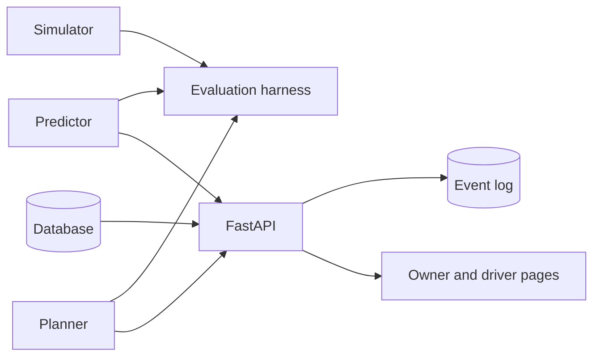

# Gasora

**Predictive depletion modeling and capacitated vehicle routing for decentralized LPG networks.**

Gasora helps an LPG distribution agency decide which customers to deliver to, and in which order. It predicts
when each customer's cylinder will run out, plans delivery routes that respect vehicle capacity and shift
length, and checks the result against simpler policies on simulated agencies. A web application records
customers, deliveries and routes around that engine.

> **Status:** active development. All evidence so far comes from simulation. The project has no real customer
> data, so it makes no claims about real-world savings.

## Overview

Gasora has two connected parts.

**Decision engine (predict, plan, verify)**

- **Simulator:** fake customers on a real city map, with steady and irregular usage patterns.
- **Predictor:** estimates each customer's 48-hour run-out risk from their own delivery history, borrows from
  similar customers when history is short, and assigns a band (Normal, High, Critical). The old rule (average
  days between deliveries) is kept as a baseline.
- **Planner:** Google OR-Tools routing in which every customer is an optional stop. The penalty for skipping a
  customer is their risk times an emergency cost. Urgent requests get a very high penalty and are pulled
  towards the start of the route.
- **Evaluation harness:** runs delivery policies day by day on the same simulated agencies and compares them
  with paired seeds and bootstrap intervals.

**Operations layer (records)**

- Login with owner and driver roles.
- Customers, deliveries, urgent requests.
- A hash-chained, append-only event log with a verification endpoint.
- An owner dispatch page (map, risk, routes, driver assignment) and a mobile-friendly driver page.



## Project structure

| Folder | Contents |
|---|---|
| `simulator/` | Customer generator with hidden usage patterns |
| `predictor/` | Baseline rule and the run-out risk predictor |
| `planner/` | OR-Tools routing, greedy routing, road-time matrix from OpenStreetMap |
| `evaluation/` | Day-by-day harness, delivery policies, sensitivity and matched-workload studies |
| `backend/` | FastAPI application, models, authentication, services, event log |
| `frontend/` | React, Vite and Leaflet web application |
| `tests/` | Automated tests |
| `data/` | Generated files: road map, local databases, result tables (not tracked by Git) |
| `docs/` | Documentation |

## Getting started

### Prerequisites

- Python 3.12 or newer
- Node.js 22 or newer
- Git

Developed with Python 3.14 and Node.js 24. The backend test suite also passes on Python 3.12.

### Installation (Windows PowerShell)

```powershell
git clone https://github.com/<Sumamasonia>/gasora.git
cd gasora
python -m venv .venv
.\.venv\Scripts\Activate.ps1
python -m pip install --upgrade pip
pip install -r requirements.txt
cd frontend
npm install
cd ..
```

If PowerShell blocks the activation script, run `Set-ExecutionPolicy -Scope CurrentUser RemoteSigned` once.

Verify the installation:

```powershell
python -m pytest -q
python -m evaluation.feasibility_check
```

All tests should pass. The feasibility check prints a risk summary for 50 simulated customers and an OR-Tools
plan. Route lengths can differ slightly between machines, because the solver stops on a timer.

### Run the application

1. Download the road network once (needs internet; retries if the public server is busy):

   ```powershell
   python -m planner.download_map
   ```

2. Create a demo database with simulated customers and two accounts:

   ```powershell
   python -m backend.manage seed-demo
   ```

   Demo accounts: `owner` / `owner-demo-123` and `driver1` / `driver-demo-123`. For demonstrations only.

3. Start the API and the web application in two terminals:

   ```powershell
   python -m uvicorn backend.main:app --reload
   ```

   ```powershell
   cd frontend
   npm run dev
   ```

4. Open http://localhost:5173. API documentation is available at http://127.0.0.1:8000/docs.

Additional accounts: `python -m backend.manage create-owner NAME` and
`python -m backend.manage create-driver NAME`.

### Configuration

| Variable | Purpose | Default |
|---|---|---|
| `GASORA_SECRET` | Signs login tokens. Set your own value outside development. | development value |
| `GASORA_DB_URL` | Database connection | `sqlite:///data/gasora.db` |
| `GASORA_EVENTS_PATH` | Event log database file | `data/gasora_events.db` |

Planning parameters (vehicles, capacity, shift length, penalties) are in `config.py` and
`backend/settings.py`. Most values are placeholders pending calibration.

## Evaluation

The harness simulates an agency day by day. Each policy sees only what a real system could know: delivery
history, days since the last delivery, and which customers have called because they ran out.

| Policy | Selection | Routing |
|---|---|---|
| P1 | Reactive (customers who ran out) | Nearest neighbour |
| P2 | Average-days rule | OR-Tools |
| P3 | Gasora risk | OR-Tools with risk-weighted skip penalties |
| Ablation | Gasora risk | Nearest neighbour |

The ablation separates the effect of prediction (whom to visit) from the effect of routing (how to drive).
Hidden cylinder durations are drawn per customer in advance, so every policy faces the same simulated world
(paired seeds).

Measures: run-outs per 100 customer-months, kilometres per delivery, total kilometres, early deliveries, and
customer-days without gas.

```powershell
python -m evaluation.harness --seeds 5 --days 30 --n 100
python -m evaluation.sensitivity --seeds 3 --days 30 --n 100
python -m evaluation.matched --seeds 10 --days 30 --n 100
```

`matched` compares Gasora with the average-days rule at equal numbers of deliveries and takes about an hour
for 10 seeds. Close heavy programs while it runs. Results of timed solver runs vary slightly between runs.

## Testing

```powershell
python -m pytest -q
```

Tests cover authentication and roles, deliveries, urgent requests, route publishing and driver actions,
planning, and tamper detection in the event log.

## Roadmap

Implemented:

- [x] Simulator with steady and irregular customers
- [x] Run-out risk predictor with bands, and the average-days baseline
- [x] OR-Tools planner with optional stops, capacity, shift length, urgent requests
- [x] Evaluation harness with four policies, paired seeds, bootstrap intervals, sensitivity and matched-workload studies
- [x] Road-time matrix builder from OpenStreetMap
- [x] Authentication, customers, deliveries, urgent requests, route publishing, driver actions
- [x] Hash-chained event log with verification and tamper tests
- [x] Owner dispatch page and driver page

Planned:

- [x] Road-time matrix in the API plan and in the evaluation runs
- [x] Refill window output from the predictor
- [ ] Cylinder register (state and owner) and empty-cylinder tracking
- [ ] Stock and purchases, payments and invoices, reports, backup
- [ ] Deployment

## Known limitations

- Evidence comes from simulation, and the predictor matches the simulator's assumptions (normal-shaped
  cylinder durations). Results show that the method works when its model fits, not how it performs on real data.
- Road travel times use assumed speeds per road type (checked against a map service on three trips) and include no traffic. Vehicle shift length is assumed to be 8 hours.
- Many parameters are placeholders: risk cut-off, skip penalty, late-arrival costs, road speeds, and the
  threshold for an early delivery.
- The event log is tamper-evident, not tamper-proof. Someone with full access to the database file can rewrite
  it unless the latest hash is also stored elsewhere. The log and the main database are separate files.
- Tested on SQLite only.

## Contributing

- Work on a branch per task and open a pull request. Do not commit directly to `main`.
- `python -m pytest -q` must pass, and new features need tests.
- Do not commit secrets, `.env` files, databases or the `data/` folder.
- Report results as measurements. Do not state savings that the evidence does not support.
